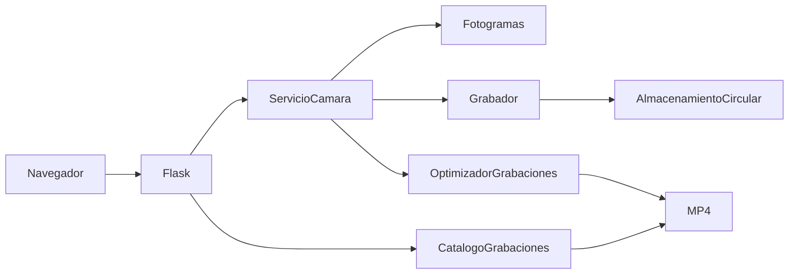

# Cómo está organizado PiCameraRecorder

El proyecto usa **Application Factory** y **Service Layer**. Son dos ideas sencillas:
`crear_app(servicio)` construye la web con un servicio recibido; `ServicioCamara`
coordina la cámara y sus salidas. Las rutas HTTP no crean otra cámara.

## Responsabilidades

| Carpeta o archivo | Para qué sirve |
| --- | --- |
| `picamera_recorder/cli.py` | Arranque, señales y bucle del servidor. |
| `config.py` | Opciones de terminal y configuración. |
| `servicio.py` | Propiedad y cierre ordenado de cámara, salidas y trabajador. |
| `grabacion.py` | Codificación H.264, segmentos, errores y bloqueo de grabación. |
| `almacenamiento.py` | Borrado circular de archivos cerrados. |
| `catalogo.py` | Lectura segura de sesiones, metadatos y archivos. |
| `optimizacion.py` | Preparación de MP4 para web en segundo plano, sin recodificar. |
| `streaming.py` | Distribución del directo a varios espectadores. |
| `app.py` | Construcción de Flask y rutas de inicio, estado y directo. |
| `rutas_grabaciones.py` | Filtros, paginación, reproducción y descargas. |
| `http_video.py` | Interpretación de rangos HTTP y envío por bloques. |
| `templates/` | Estructura HTML y componentes visuales. |
| `static/css/` | Diseño adaptable. |
| `static/js/` | Panel, biblioteca y utilidades de presentación. |
| `tests/` | Pruebas sin usar la cámara real; datos temporales. |
| `scripts/` | Verificación opcional con cámara real. |

El catálogo se construye una sola vez y se comparte con la web y el optimizador.
Su listado reutiliza los metadatos del barrido para evitar consultar cada archivo
dos veces. Al abrir una sesión cerrada no necesita volver a listar sus vídeos.

## Cierres y concurrencia

`ExitStack` registra el cierre de recursos en orden inverso a su creación. El
trabajador se detiene antes de liberar la cámara. El grabador conserva un bloqueo
exclusivo durante toda la vida del archivo abierto; el catálogo usa ese estado para
impedir su reproducción o descarga prematura.

La limpieza circular y el reemplazo de un MP4 preparado comparten un bloqueo breve.
La copia, la validación y las sincronizaciones grandes quedan fuera de ese bloqueo.
Así no se mantiene detenido el bucle principal mientras se prepara un vídeo.

## Interfaz

`index.html` compone navegación, visor, sesión y biblioteca mediante includes de
Jinja. `panel.js` controla directo/estado; `grabaciones.js` controla filtros y vídeo
guardado. Son módulos nativos del navegador. Comparten utilidades explícitas y dos
funciones para pausar/reanudar el visor: no dependen de variables globales mutables.
No se necesita npm ni un proceso de compilación.

## Dónde ampliar

- Una operación de cámara nueva pertenece al servicio; una ruta la llama.
- Una consulta de vídeos nueva pertenece al catálogo o al Blueprint de grabaciones.
- Un cambio de diseño pertenece a CSS o a un componente HTML.
- El comportamiento de un botón pertenece al módulo JavaScript de su sección.

Las entradas antiguas `web.py`, `grabador.py`, `main.py` y `foto.py` se conservan:
siguen proporcionando compatibilidad, diagnóstico y captura de fotos.

## Estado de la Raspberry

El panel muestra temperatura de CPU, tiempo desde el último encendido y errores actuales de grabación. Se actualiza cada tres segundos. Si una lectura del sistema no está disponible, muestra «No disponible»; si se pierde la conexión, indica que no puede confirmar el estado. No es un historial de errores del sistema operativo. Las lecturas se realizan en picamera_recorder/sistema.py, sin dependencias adicionales.

## Eliminar grabaciones desde la web

En Grabaciones, pulsa Eliminar en un archivo cerrado y confirma el nombre y la sesión. El borrado es definitivo; no existe papelera. El archivo en curso no se puede borrar. Si está reproduciéndose el archivo eliminado, el visor vuelve al directo. La lista se actualiza al terminar y el espacio libre, en la siguiente lectura. Solo elimina MP4 propios dentro de grabaciones; las carpetas de sesión se conservan. El borrado comparte el bloqueo de retención y optimización, y exige una petición DELETE con cabecera propia desde la misma web. No añade autenticación: se mantiene el acceso por red local o Tailscale.

## Movimiento en la web

Se analizan imágenes reducidas (160 × 90, hasta cuatro por segundo) en un hilo independiente. No se envían avisos externos. El panel muestra actividad, última detección y sensibilidad baja/media/alta; el cambio de sensibilidad dura hasta reiniciar. Hay dos segundos iniciales de calibración y se requieren tres muestras positivas. Dos segundos de calma agrupan la actividad. Luces, sombras y movimiento de la propia cámara pueden producir detecciones; no distingue personas.

Al reproducir un vídeo, Momentos con movimiento muestra eventos y permite saltar tres segundos antes. Los tiempos son aproximados por el muestreo y la alineación del directo y el codificador. Solo se analizan nuevas grabaciones, sin análisis retroactivo. Los límites de segmentos se leen del CSV del muxer (.segmentos.csv). Los eventos se conservan en .movimiento.sqlite3, dentro de grabaciones. Al borrar vídeos, sus eventos dejan de estar disponibles y se purgan en hasta 30 segundos mientras la aplicación está en marcha. No se modifica ni recodifica el vídeo. Si falla la detección o el almacenamiento de eventos, se muestra el error y la grabación continúa.

## Servicio de arranque automático

PiCameraRecorder está configurado como servicio del sistema `picamera-recorder.service`, ejecutado como usuario `yago`. Arranca al encender la Raspberry, sin abrir sesión ni dejar una terminal abierta. Si el proceso falla, systemd intenta reiniciarlo a los cinco segundos (hasta cinco arranques en un minuto). Los errores de grabación que mantienen la web abierta siguen requiriendo revisión; no son un fallo del proceso.

| Acción | Comando |
| --- | --- |
| Ver estado | `systemctl status picamera-recorder --no-pager` |
| Iniciar ahora | `sudo systemctl start picamera-recorder` |
| Detener ahora, cerrando el vídeo | `sudo systemctl stop picamera-recorder` |
| Reiniciar la aplicación | `sudo systemctl restart picamera-recorder` |
| Desactivar arranque y detener | `sudo systemctl disable --now picamera-recorder` |
| Activar arranque e iniciar | `sudo systemctl enable --now picamera-recorder` |
| Consultar mensajes recientes | `journalctl -u picamera-recorder -n 50 --no-pager` |
| Seguir mensajes en directo | `journalctl -u picamera-recorder -f` |

**Ctrl + C ya no detiene el servicio.** En el comando de seguimiento de mensajes solo deja de mostrar el registro. Para parar la cámara usa `sudo systemctl stop picamera-recorder`.

Después de detener el servicio puedes usar el comando manual del proyecto; no ejecutes ambos a la vez. Desactivar el servicio no borra vídeos ni código. Si solo lo detienes, volverá a arrancar al encender la Raspberry mientras siga habilitado.

Para apagar: puedes detener primero el servicio y luego apagar desde el menú o con `sudo poweroff`. Durante el apagado normal, systemd también solicita un cierre ordenado. No desconectes la alimentación mientras graba.

La configuración mantenida está en `deploy/picamera-recorder.service`; la copia que usa systemd está en `/etc/systemd/system/picamera-recorder.service`. Si cambias el usuario o mueves el proyecto, hay que adaptar ambas rutas, instalar de nuevo la unidad y ejecutar `sudo systemctl daemon-reload`.

## Protección de grabaciones importantes

`importantes.py` mantiene una marca vacía `.video_NNNNN.mp4.importante` junto a cada vídeo protegido. Se crea de forma exclusiva y se sincroniza a disco, sin modificar el MP4. Cualquier entrada con ese nombre protege el vídeo; no se siguen enlaces. Los errores de consulta impiden borrar. El catálogo valida sesión, nombre y fichero regular, permite proteger el activo y expone `importante` en el listado. La ruta PUT `/api/grabaciones/<sesion>/<nombre>/importante` recibe un booleano y exige la misma cabecera y origen que el borrado. Comparte el bloqueo de retención y optimización, por lo que marcar y borrar no se intercalan. La limpieza consulta la marca justo antes de eliminar; el borrado manual devuelve 409 para vídeos importantes. Si faltan archivos borrables, se aplica la parada por falta de reserva existente. La marca no se hereda al siguiente segmento.
